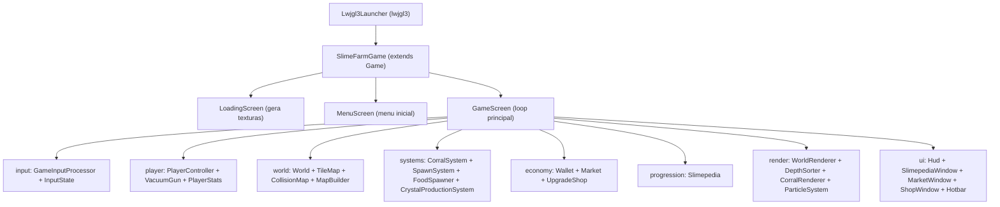

# Guia de Estudo do Código — Slime Farm Iso (Java + libGDX)

> **Objetivo deste documento:** servir como roteiro de estudo e cola para a apresentação ao professor de **Desenvolvimento Backend**. Aqui está explicado **onde fica cada funcionalidade**, **qual classe Java é responsável por quê** e **como a biblioteca libGDX é utilizada**, seguindo o princípio de **Responsabilidade Única (uma classe pública por arquivo)**.

---

## 1. Visão Geral da Arquitetura (Orientação a Objetos + libGDX)

O projeto é dividido em dois módulos Gradle:
- **`lwjgl3/`**: contém apenas o inicializador desktop ([`Lwjgl3Launcher.java`](lwjgl3/src/main/java/com/slimefarm/lwjgl3/Lwjgl3Launcher.java)), que cria a janela OpenGL de 1280×720 a 60 FPS e instancia a classe principal do jogo.
- **`core/`**: contém toda a lógica e renderização do jogo dividida em **14 pacotes** dentro de `com.slimefarm`:

---

## 2. Onde Fica Cada Lógica? (Perguntas Clássicas de Apresentação)

### 2.1. "Onde fica o código que faz o boneco andar no WASD?"
A movimentação do jogador é dividida em **3 classes** para separar captura de teclado, cálculo de direção isométrica e física/colisão:

1. **Captura das teclas (`W, A, S, D`, `Shift`)**:
   - Arquivo: [`input/GameInputProcessor.java`](core/src/main/java/com/slimefarm/input/GameInputProcessor.java) (estende `InputAdapter` do libGDX).
   - O método `keyDown(int keycode)` e `keyUp(int keycode)` ouve os eventos do teclado e liga/desliga os booleanos `up`, `down`, `left`, `right` e `run` dentro do objeto [`input/InputState.java`](core/src/main/java/com/slimefarm/input/InputState.java).
2. **Conversão do WASD para velocidade no mundo isométrico**:
   - Arquivo: [`player/PlayerController.java`](core/src/main/java/com/slimefarm/player/PlayerController.java) — método `update(float dt, Viewport viewport)`.
   - Lê `input.up/down/left/right`, chama `IsoUtils.screenDirToWorld(dx, dy, tmpDir)` para converter a direção da tela para a grade inclinada do mapa, multiplica por `Constants.PLAYER_SPEED` e pelo bônus das **Botas Turbo** (`player.getStats().getSpeedMultiplier()`), e se `Shift` estiver pressionado (`input.run`), gasta energia azul (`consumeEnergy`) para multiplicar a velocidade por `1.7x`.
   - Nesse mesmo método, converte a posição do mouse na janela (`viewport.unproject`) para coordenadas de mundo (`IsoUtils.screenToWorld`) para atualizar para onde o personagem está olhando/mirando (`player.setAimWorld`).
3. **Aplicação do movimento e colisão**:
   - Arquivo: [`entities/Player.java`](core/src/main/java/com/slimefarm/entities/Player.java) (herda de [`entities/LivingEntity.java`](core/src/main/java/com/slimefarm/entities/LivingEntity.java), que herda de [`entities/Entity.java`](core/src/main/java/com/slimefarm/entities/Entity.java)).
   - No método `Player.update(World world, float dt)`, ele chama `moveWithCollision(world, dt)` (definido em `LivingEntity`), que delega ao [`world/CollisionMap.java`](core/src/main/java/com/slimefarm/world/CollisionMap.java) para mover eixo X e eixo Y separadamente, deslizando em árvores, pedras, cercas e penhascos.

---

### 2.2. "Onde fica a matemática 2D Isométrica e a ordenação de profundidade?"
- **Conversão Mundo ↔ Tela**:
  - Arquivo: [`util/IsoUtils.java`](core/src/main/java/com/slimefarm/util/IsoUtils.java).
  - Fórmulas usadas:
    - `toScreenX(x, y) = (x - y) * (TILE_W / 2)`
    - `toScreenY(x, y, z) = -(x + y) * (TILE_H / 2) + z * Z_PIXELS`
    - `screenToWorld(sx, sy)`: faz a matriz inversa para descobrir em qual tile do chão o mouse está clicando/mirando.
- **Quem está atrás e quem está na frente (Painter's Algorithm)**:
  - Arquivo: [`render/DepthSorter.java`](core/src/main/java/com/slimefarm/render/DepthSorter.java).
  - Ordena todas as entidades pela soma `depth = x + y` crescente. Assim, quando o jogador passa atrás de uma árvore, a árvore tem `x + y` maior e é desenhada **depois** do jogador, cobrindo-o corretamente.

---

### 2.3. "Como o jogador consegue atravessar o vidro do curral, mas os slimes ficam presos lá dentro (e os de fora não entram)?"
Essa mecânica foi separada em **3 pontos**:

1. **Sem parede física para o jogador**:
   - Arquivo: [`entities/props/Corral.java`](core/src/main/java/com/slimefarm/entities/props/Corral.java).
   - O `Corral` guarda o retângulo `bounds` (6×6 tiles), mas **não registra paredes no `CollisionMap`**. Por isso, o `Player` atravessa o vidro livremente em qualquer direção para entrar no cercado e capturar um slime específico.
2. **Flags de estado no Slime**:
   - Arquivo: [`entities/slimes/Slime.java`](core/src/main/java/com/slimefarm/entities/slimes/Slime.java).
   - Cada slime possui dois atributos booleanos:
     - `corralled`: indica se o slime pertence ao curral (está confinado lá dentro).
     - `launchedByPlayer`: fica `true` quando o slime é disparado pelo aspirador do jogador (`Slime.launch(vx, vy, vz)`).
3. **Barreira seletiva de mão dupla**:
   - Arquivo: [`systems/CorralSystem.java`](core/src/main/java/com/slimefarm/systems/CorralSystem.java) — método `update(World world)`.
   - Para cada `Slime` do mundo:
     - **Se `s.isCorralled()` é `true`**: qualquer tentativa de passar das bordas internas do curral rebate a posição e inverte a velocidade do slime. Ele nunca sai sozinho.
     - **Se `s.isCorralled()` é `false` (slime de fora)**:
       - Se ele tentar encostar no curral andando/pulando por conta própria (`!s.isLaunchedByPlayer()`), o método `pushOutside(...)` empurra-o para fora do vidro. Slimes selvagens **nunca entram sozinhos**.
       - Se ele foi **jogado pelo jogador** (`s.isLaunchedByPlayer() == true`) e caiu dentro do retângulo do curral (`bounds.contains(x, y)`), o sistema marca `s.setCorralled(true)` e ele passa a morar preso dentro do cercado!

---

### 2.4. "Onde fica a lógica de Spawn de Slimes, Biomas, Porcentagens e Campo de Visão?"
Essa mecânica fica dividida em **4 classes**:

1. **Definição dos 4 Biomas**:
   - Arquivo: [`world/BiomeType.java`](core/src/main/java/com/slimefarm/world/BiomeType.java).
   - Define `RANCH` (Rancho Central), `MEADOW` (Pradaria Florida), `MOSS_FOREST` (Floresta de Musgo) e `CRYSTAL_QUARRY` (Pedreira Cristalina).
   - Em [`world/MapBuilder.java`](core/src/main/java/com/slimefarm/world/MapBuilder.java), o mapa `80×80` é construído dividindo os 4 quadrantes nesses biomas, conectados por estradas de terra e pontes.
2. **Porcentagem de Spawn e Biomas de cada Slime**:
   - Arquivo: [`entities/slimes/SlimeType.java`](core/src/main/java/com/slimefarm/entities/slimes/SlimeType.java).
   - Cada espécie declara sua `spawnChancePercent` e seu array `allowedBiomes`:
     - **`PINK` (`PinkSlime.java`)**: **45%** — aparece em **Todos os Biomas**.
     - **`CAT` (`CatSlime.java`)**: **25%** — aparece na **Pradaria Florida** e **Floresta de Musgo**.
     - **`ROCK` (`RockSlime.java`)**: **25%** — aparece na **Pedreira Cristalina** e **Pradaria Florida**.
     - **`HONEY` (`HoneySlime.java`)**: **12%** — exclusivo da **Floresta de Musgo**.
     - **`PHOSPHOR` (`PhosphorSlime.java`)**: **10%** — aparece na **Floresta de Musgo** e **Pradaria Florida**.
     - **`GOLD` (`GoldSlime.java`)**: **3%** — exclusivo da **Pedreira Cristalina**.
3. **Zonas de Spawn (`SpawnZone`)**:
   - Arquivo: [`systems/SpawnZone.java`](core/src/main/java/com/slimefarm/systems/SpawnZone.java).
   - Guarda o centro `(x, y)`, o raio, o `BiomeType`, o limite máximo de slimes daquela área e o booleano `wasInView` (se estava no campo de visão da câmera).
4. **Reabastecimento quando a área sai do campo de visão (`SpawnSystem`)**:
   - Arquivo: [`systems/SpawnSystem.java`](core/src/main/java/com/slimefarm/systems/SpawnSystem.java).
   - No método `update(World world, OrthographicCamera camera)`:
     - Calcula se o centro da `SpawnZone` está dentro do retângulo visível da `OrthographicCamera` do jogador (`inView`).
     - Quando o jogador se afasta e a zona **sai do campo de visão** (`zone.isWasInView() && !inView`), chama `replenishZone(world, zone)`.
     - O método `rollSlimeForBiome(BiomeType biome)` soma os pesos (`spawnChancePercent`) dos slimes que podem aparecer naquele bioma (`t.canSpawnIn(biome)`) e sorteia proporcionalmente qual subclasse de `Slime` criar!

---

### 2.5. "Onde fica a Inteligência Artificial (IA) dos Slimes e a produção de Cristais?"
- **Hierarquia OO dos Slimes (`entities/slimes/`)**:
  - [`Slime.java`](core/src/main/java/com/slimefarm/entities/slimes/Slime.java) (classe abstrata) → herdada por [`PinkSlime.java`](core/src/main/java/com/slimefarm/entities/slimes/PinkSlime.java), [`CatSlime.java`](core/src/main/java/com/slimefarm/entities/slimes/CatSlime.java), [`RockSlime.java`](core/src/main/java/com/slimefarm/entities/slimes/RockSlime.java), [`HoneySlime.java`](core/src/main/java/com/slimefarm/entities/slimes/HoneySlime.java), [`PhosphorSlime.java`](core/src/main/java/com/slimefarm/entities/slimes/PhosphorSlime.java) e [`GoldSlime.java`](core/src/main/java/com/slimefarm/entities/slimes/GoldSlime.java).
  - Polimorfismo: `RockSlime` sobrescreve `onCustomUpdate(World, dt)` para causar dano ao jogador quando está faminto/agitado.
- **Máquina de Estados e Pulos (`ai/`)**:
  - [`ai/SlimeBrain.java`](core/src/main/java/com/slimefarm/ai/SlimeBrain.java): controla os estados (`IDLE`, `WANDER`, `SEEK_FOOD`, `EAT`, `HAPPY`, `AGITATED`). Se `slime.isHungry()` for verdadeiro, usa [`ai/SeekFoodBehavior.java`](core/src/main/java/com/slimefarm/ai/SeekFoodBehavior.java) para localizar a fruta/vegetal mais próxima (priorizando a comida favorita); caso contrário, usa [`ai/WanderBehavior.java`](core/src/main/java/com/slimefarm/ai/WanderBehavior.java) para passear.
  - [`ai/HopMovement.java`](core/src/main/java/com/slimefarm/ai/HopMovement.java): aplica gravidade no eixo `z` (altura do pulo) e calcula o efeito elástico *squash & stretch* (`scaleX`, `scaleY`).
- **Produção de Cristais**:
  - Quando o slime alcança uma [`FoodItem`](core/src/main/java/com/slimefarm/entities/items/FoodItem.java), o método `Slime.eat(FoodItem)` remove a fruta, reduz a fome e agenda 1 cristal (ou **2 cristais** se for a comida favorita daquela espécie).
  - [`systems/CrystalProductionSystem.java`](core/src/main/java/com/slimefarm/systems/CrystalProductionSystem.java) verifica `slime.pollCrystalReady()` e instancia o [`CrystalItem`](core/src/main/java/com/slimefarm/entities/items/CrystalItem.java) correspondente no mundo.

---

### 2.6. "Onde fica o Aspirador (Vac Gun) e a Hotbar de 8 slots?"
- **Aspirador**:
  - Arquivo: [`player/VacuumGun.java`](core/src/main/java/com/slimefarm/player/VacuumGun.java).
  - **Botão Esquerdo (`applyVacuumCone`)**: calcula o produto escalar (`dot product`) entre a direção da mira do jogador e o vetor até cada entidade próxima. Se estiver dentro do cone de `35°` e do alcance (`VACUUM_RANGE + bônus de upgrade`), puxa o item/slime em direção ao bico (`pullTowards`). Ao encostar no bico, adiciona ao [`inventory/Inventory.java`](core/src/main/java/com/slimefarm/inventory/Inventory.java) e, se for um slime, registra a captura na [`progression/Slimepedia.java`](core/src/main/java/com/slimefarm/progression/Slimepedia.java).
  - **Botão Direito (`shootSelected`)**: retira 1 unidade do slot selecionado (`inventory.popSelected()`) e lança no mundo na direção do mouse.
- **Inventário e Hotbar**:
  - [`inventory/Inventory.java`](core/src/main/java/com/slimefarm/inventory/Inventory.java) e [`inventory/InventorySlot.java`](core/src/main/java/com/slimefarm/inventory/InventorySlot.java): guardam os 8 slots (empilhando itens iguais até a capacidade máxima).
  - [`ui/Hotbar.java`](core/src/main/java/com/slimefarm/ui/Hotbar.java) e [`ui/HotbarSlotView.java`](core/src/main/java/com/slimefarm/ui/HotbarSlotView.java): desenham os 8 quadrados na base da tela com borda amarela no slot ativo.

---

### 2.7. "Onde fica a Slimepedia (Pokédex de Slimes)?"
- **Modelo de Dados**:
  - Arquivo: [`progression/Slimepedia.java`](core/src/main/java/com/slimefarm/progression/Slimepedia.java).
  - Usa um `EnumSet<SlimeType>` para guardar quais espécies o jogador já capturou com o aspirador (`registerCapture(SlimeType)` e `isCaptured(SlimeType)`).
- **Interface Gráfica e Silhueta Preta**:
  - Arquivo: [`ui/SlimepediaWindow.java`](core/src/main/java/com/slimefarm/ui/SlimepediaWindow.java).
  - Aberta clicando no botão **`[P] Slimepedia`** no canto superior direito do [`ui/Hud.java`](core/src/main/java/com/slimefarm/ui/Hud.java) ou apertando as teclas **`P`** / **`Tab`**.
  - Se `slimepedia.isCaptured(t)` for **`true`**: desenha o sprite colorido (`batch.setColor(Color.WHITE)`), nome, comida favorita, preço do cristal, porcentagem de spawn e biomas.
  - Se `slimepedia.isCaptured(t)` for **`false`**: desenha a **silhueta totalmente preta** (`batch.setColor(0f, 0f, 0f, 1f)`), oculta o nome (`"???"`) e mostra **somente a porcentagem de chance de aparecer e em qual bioma**!

---

### 2.8. "Onde ficam o Mercado de Cristais e a Loja de Upgrades (para gastar moedas)?"
- **Carteira e Mercado (`economy/`)**:
  - [`economy/Wallet.java`](core/src/main/java/com/slimefarm/economy/Wallet.java): controla o saldo de moedas (`add`, `spend`, `loseFraction`).
  - [`economy/PriceTable.java`](core/src/main/java/com/slimefarm/economy/PriceTable.java) e [`economy/Market.java`](core/src/main/java/com/slimefarm/economy/Market.java): calculam a variação diária de preços (±30%) e vendem os cristais do inventário ou atirados no [`entities/props/MarketTerminal.java`](core/src/main/java/com/slimefarm/entities/props/MarketTerminal.java).
  - [`ui/MarketWindow.java`](core/src/main/java/com/slimefarm/ui/MarketWindow.java): janela aberta com `E` perto do terminal do mercado.
- **Loja de Upgrades (`economy/` e `ui/`)**:
  - [`economy/UpgradeType.java`](core/src/main/java/com/slimefarm/economy/UpgradeType.java): enumera os 5 upgrades compráveis (`ENERGY_TANK`, `JET_BOOTS`, `VACUUM_BOOSTER`, `BACKPACK_SLOT`, `SUIT_ARMOR`), seus custos e nível máximo.
  - [`economy/UpgradeShop.java`](core/src/main/java/com/slimefarm/economy/UpgradeShop.java): verifica se há moedas suficientes na `Wallet`, incrementa o nível do upgrade e chama `applyAll(Player)` para aumentar imediatamente a energia máxima, velocidade de movimento, alcance/força do aspirador, capacidade da hotbar e vida máxima.
  - [`entities/props/ShopTerminal.java`](core/src/main/java/com/slimefarm/entities/props/ShopTerminal.java) e [`ui/ShopWindow.java`](core/src/main/java/com/slimefarm/ui/ShopWindow.java): quiosque dourado à esquerda do Mercado no Rancho (interagível com `E` ou tecla `U`), onde as teclas `1`–`5` compram os upgrades.

---

### 2.9. "Como funciona o Salvamento em JSON (`save/`)?"
- [`save/SaveData.java`](core/src/main/java/com/slimefarm/save/SaveData.java): classe POJO serializável que armazena moedas, dia, itens dos 8 slots, slimes dentro do curral, espécies descobertas na Slimepedia e níveis comprados na Loja de Upgrades.
- [`save/SaveManager.java`](core/src/main/java/com/slimefarm/save/SaveManager.java): usa a classe `com.badlogic.gdx.utils.Json` e `Gdx.files.local("slimefarm_save.json")` do libGDX para gravar (tecla `F5` ou ao sair para o menu) e recarregar o progresso.

---

## 3. Resumo das Classes da Biblioteca libGDX Utilizadas

| Classe do libGDX | Onde é usada no projeto | Para que serve |
|---|---|---|
| `Game` / `ScreenAdapter` | `SlimeFarmGame`, `LoadingScreen`, `MenuScreen`, `GameScreen` | Ciclo de vida do jogo (`create`, `render`, `resize`, `dispose`) e troca de telas |
| `OrthographicCamera` + `ExtendViewport` | `GameScreen`, `Hud`, `MenuScreen` | Câmera 2D com zoom/posição suave (`lerp`) no mundo e câmera fixa separada para o HUD |
| `SpriteBatch` | `GameScreen`, `WorldRenderer`, `Hud` | Desenho acelerado por GPU de todas as texturas (`TextureRegion`) em lote |
| `Pixmap` + `Texture` | `TextureFactory` e todas as `*TextureFactory` | Geração procedural pixel a pixel de todos os sprites originais em memória RGBA8888 |
| `ShapeRenderer` | `LoadingScreen`, `StatBar`, `Hotbar`, `VacuumBeamRenderer`, janelas de UI | Desenho de barras de vida/energia, molduras das janelas e cone translúcido do aspirador |
| `BitmapFont` | `Assets`, `Hud`, `SlimepediaWindow`, `MarketWindow`, `ShopWindow` | Renderização de textos, preços, quantidades da hotbar e nomes dos biomas |
| `InputAdapter` + `Gdx.input` | `GameInputProcessor`, `GameScreen` | Captura orientada a eventos de teclado (WASD, atalhos) e mouse (mira, clique e scroll) |
| `Vector2`, `Vector3`, `Rectangle`, `MathUtils` | `IsoUtils`, `CollisionMap`, `CorralSystem`, `PlayerController` | Geometria vetorial 2D, colisão circular/retangular e interpolação da câmera |
| `Json` + `FileHandle` | `SaveManager` | Persistência de estado do jogo em arquivo JSON local |

