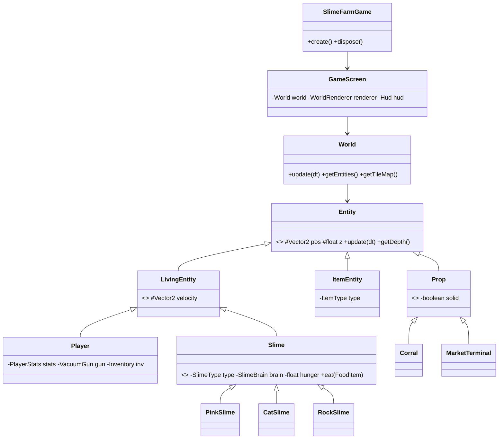

# Plano de Implementação — "Slime Farm Iso" (jogo 2D isométrico em Java + libGDX)

> **Para qualquer agente de IA que abrir este projeto:**
> 1. Leia este arquivo inteiro (arquitetura e regras).
> 2. Abra [`TAREFAS.md`](TAREFAS.md) e continue da **primeira tarefa que não está ✅**.
> 3. Siga o **Protocolo de Status** descrito em `TAREFAS.md` (marcar 🔄 ao começar, ✅ ao terminar, registrar no Log).
> 4. Imagem de referência visual: [`docs/referencia.jpg`](docs/referencia.jpg).

---

## 1. Objetivo

Criar um jogo 2D **isométrico**, inspirado nas mecânicas de jogos de "fazenda de slimes" (estilo Slime Rancher), com visual pixel‑art igual ao da imagem de referência. Trabalho acadêmico de Desenvolvimento Backend: o foco é **orientação a objetos, uma classe por arquivo, responsabilidades bem separadas**.

> [!IMPORTANT]
> **Direitos autorais:** NÃO copiar sprites, sons, músicas, logos ou textos do jogo original. Toda a arte é **original**: gerada via código (`Pixmap`) ou desenhada/gerada pelo grupo. Os nomes também são próprios (ex.: "Cristal" no lugar do item do jogo original, "Mercado de Cristais" etc.). Só as *mecânicas gerais* servem de inspiração.

### O que aparece na imagem de referência (e precisa existir no jogo)
| Elemento | Descrição |
|---|---|
| Terreno | Mapa isométrico: área central de **terra**, bordas de **grama**, **penhascos** (desnível) nas bordas, **caminhos de pedra** |
| Decoração | Árvores, arbustos, flores, pedras grandes, **cercas de madeira**, **ponte de madeira** (canto inferior esquerdo), **portão** (canto superior esquerdo) |
| Jogador | Personagem de traje espacial + mochila + **aspirador (vac gun)** que solta um feixe com partículas coloridas |
| Slimes | **Slime Rosa** (redondo), **Slime Gatinho** (rosa com orelhinhas), **Slime Pedra** (cinza com espinhos) |
| Itens | Frutas (morango, maçã), vegetais (cenoura), **Cristais** coloridos (produzidos pelos slimes) |
| Curral | Cercado com **paredes de vidro brilhantes** e postes de metal, slimes presos dentro |
| Mercado | **Terminal "Mercado de Cristais"** (canto superior direito) com tela mostrando preços |
| HUD | Canto sup. esq.: barra de **vida** (vermelha, ícone coração), barra de **energia** (azul, ícone raio), **moedas** (ícone moeda + "10050") |
| Hotbar | Base da tela: **8 slots**, ícone do item + quantidade, slot selecionado com borda **amarela** |

---

## 2. Stack e Ambiente

| Item | Escolha |
|---|---|
| Linguagem | Java **17** (compila com `sourceCompatibility = 17`) |
| Framework | **libGDX 1.12.1** (ou mais recente estável) |
| Build | **Gradle Wrapper** (`gradlew`), projeto multi‑módulo: `core` + `lwjgl3` |
| Backend desktop | LWJGL3 |
| Extensões | Nenhuma obrigatória (sem Box2D/Ashley, para manter o código didático) |

> [!WARNING]
> A máquina atual tem **Java 8 (32 bits)** e **não tem Gradle**. Antes da Fase 0 é preciso instalar um **JDK 17 64‑bit** (ex.: Eclipse Temurin 17) e definir `JAVA_HOME`. O Gradle vem pelo wrapper (`gradlew.bat`), não precisa instalar.

**Comandos:**
- Rodar: `.\gradlew.bat lwjgl3:run`
- Compilar/verificar: `.\gradlew.bat build`

---

## 3. Arquitetura

### 3.1 Estrutura de pastas
```
slime-rancher-java/
├── PLANO_IMPLEMENTACAO.md      ← este arquivo
├── TAREFAS.md                  ← status das tarefas (atualizar sempre!)
├── docs/referencia.jpg
├── settings.gradle / build.gradle / gradle.properties / gradlew(.bat) / gradle/
├── assets/                     ← (opcional) PNGs, fontes, sons originais
├── lwjgl3/src/main/java/com/slimefarm/lwjgl3/Lwjgl3Launcher.java
└── core/src/main/java/com/slimefarm/
    ├── SlimeFarmGame.java
    ├── util/        Constants, Direction, IsoUtils, RandomUtils
    ├── assets/      Assets, TextureFactory, SpriteFactory (sub-fábricas por tipo)
    ├── screens/     LoadingScreen, MenuScreen, GameScreen
    ├── world/       World, TileMap, Tile, TileType, MapBuilder, CollisionMap
    ├── entities/    Entity, LivingEntity, Player, ...
    │   ├── slimes/  Slime, PinkSlime, CatSlime, RockSlime, SlimeType, SlimeState
    │   ├── items/   ItemEntity, ItemType, FoodItem, CrystalItem
    │   └── props/   Prop, Tree, Bush, Rock, Fence, Gate, Bridge, Corral, MarketTerminal
    ├── ai/          SlimeBrain, WanderBehavior, SeekFoodBehavior, HopMovement
    ├── player/      PlayerController, PlayerStats, VacuumGun
    ├── inventory/   Inventory, InventorySlot
    ├── economy/     Wallet, Market, PriceTable
    ├── systems/     SpawnSystem, FoodSpawner, CrystalProductionSystem, CorralSystem
    ├── render/      WorldRenderer, DepthSorter, ShadowRenderer, ParticleSystem, Particle, VacuumBeamRenderer
    ├── ui/          Hud, StatBar, CoinCounter, Hotbar, HotbarSlotView, MarketWindow
    ├── input/       GameInputProcessor, InputState
    ├── save/        SaveManager, SaveData
    └── audio/       SoundManager
```

### 3.2 Regras de código (obrigatórias)
1. **Uma classe pública por arquivo.** Nada de classes gigantes "faz‑tudo".
2. Separar **lógica** de **desenho**: toda `Entity` tem `update(World, dt)` (só lógica) e `render(SpriteBatch, Assets)` (só desenho). Chão, sombras, efeitos e HUD ficam em `render/` e `ui/`. Texturas são geradas nas fábricas de `assets/` (uma fábrica por grupo: tiles, props, slimes, itens, jogador, UI), cada uma implementando `Assets.LoadTask` e registrada em `SlimeFarmGame.create()`.
3. Constantes numéricas em `util/Constants.java` (tamanho de tile, velocidades, preços base…).
4. Usar `enum` para tipos (`TileType`, `SlimeType`, `ItemType`, `SlimeState`, `Direction`).
5. Herança + polimorfismo: `Entity → LivingEntity → Slime → PinkSlime/CatSlime/RockSlime`; `Entity → ItemEntity`; `Entity → Prop → Tree/Fence/...`.
6. Comentários **Javadoc em português** em toda classe e método público.
7. Liberar recursos (`dispose()`) de `Texture`, `SpriteBatch`, `ShapeRenderer`, `BitmapFont`.
8. Ao terminar cada tarefa o projeto **precisa compilar** (`gradlew build`).

### 3.3 Diagrama de classes (principal)


### 3.4 Sistema isométrico (padrão do projeto)
- Tile em losango: **`TILE_W = 64`, `TILE_H = 32`** pixels (arte em pixel‑art, escala 2x).
- Coordenadas de **mundo** em unidades de tile (`float x, y`); `z` = altura (pulo dos slimes / penhascos).
- Conversão (em `IsoUtils`), com Y da tela para cima (padrão libGDX):
  - `screenX = (x - y) * TILE_W / 2`
  - `screenY = -(x + y) * TILE_H / 2 + z * TILE_H`
  - Inversa (mouse → mundo): `x = (sx / (TILE_W/2) - sy / (TILE_H/2)) / 2`, `y = (-sx / (TILE_W/2) - sy / (TILE_H/2)) / 2`
- **Ordenação de profundidade** (`DepthSorter`): desenhar primeiro tiles do chão, depois todas as entidades/props ordenadas por `(x + y)` crescente (quem está "mais na frente" desenha por último).
- Movimento do jogador com WASD **alinhado à tela** (W = sobe na tela) → converter para vetor de mundo.
- Câmera `OrthographicCamera` seguindo o jogador com *lerp* suave; viewport `ExtendViewport` 960×540.

### 3.5 Arte (original)
- Fase inicial: `TextureFactory` gera **todas as texturas via `Pixmap`** (losangos de grama/terra/pedra, slimes como elipses com olhos, cristais como losangos, etc.) → o jogo roda sem nenhum arquivo externo.
- Fase de polimento: substituir por PNGs pixel‑art **originais** em `assets/` (desenhados ou gerados pelo grupo), mantendo os mesmos nomes de região no `Assets`.
- Paleta inspirada na referência: grama `#5DAA3C/#3F8A2E`, terra `#B9763F/#9A5E30`, penhasco `#7A4A2A`, pedra `#9C9C9C`, slime rosa `#F0507A`, vidro curral `#A8F0FF` (alpha 0.35), HUD vida `#E43B44`, energia `#3FA9F5`.

### 3.6 Mecânicas (escopo)
| Mecânica | Regras |
|---|---|
| Movimento | WASD; Shift = correr (gasta energia); colisão com props sólidos, cercas, penhascos, paredes do curral |
| Aspirar | **Botão esquerdo**: cone na direção do mouse (alcance 4 tiles, ângulo 35°). Itens e slimes pequenos são puxados e, ao encostar no bico, vão para o inventário. Gasta pouca energia |
| Atirar | **Botão direito**: dispara 1 unidade do slot selecionado na direção do mouse (vira entidade no mundo) |
| Hotbar | 8 slots; teclas **1–8** e **scroll** trocam slot; cada slot guarda **1 tipo** de item, máx. 20 |
| Slimes | IA com estados: `IDLE`, `WANDER`, `SEEK_FOOD`, `EAT`, `HAPPY`, `AGITATED`; movimento por **pulinhos** (z sobe/desce) com sombra no chão |
| Fome / Cristais | Fome aumenta com o tempo; slime com fome procura comida próxima; ao comer, produz 1 **Cristal** da sua cor após 2s |
| Slime Pedra | Quando agitado (fome alta ou atingido), rola em direção ao jogador e causa **dano** por contato |
| Curral | Área retangular com paredes de vidro: slimes dentro não saem; jogador entra/sai pelo vão/porta |
| Mercado | Tecla **E** perto do terminal abre `MarketWindow`: vende cristais do inventário; preços variam a cada "dia" (± 30%) |
| Spawns | Frutas/vegetais nascem perto de árvores/arbustos periodicamente; slimes selvagens nascem fora do curral até um limite |
| Vida/Energia | Vida máx. 100, regenera devagar; energia máx. 100, regenera quando não está correndo/aspirando; vida 0 → reaparece na casa e perde 10% das moedas |
| Save | `SaveManager` salva moedas, inventário, slimes do curral em JSON (`Preferences` ou arquivo local) |

---

## 4. Fases (resumo — detalhes e status em `TAREFAS.md`)

```mermaid
flowchart LR
    F0["F0 Setup"] --> F1["F1 Núcleo/Iso"] --> F2["F2 Mundo/Mapa"] --> F3["F3 Jogador"]
    F3 --> F4["F4 Itens/Inventário"] --> F5["F5 Slimes/IA"] --> F6["F6 Curral/Cristais"]
    F6 --> F7["F7 Economia/Mercado"] --> F8["F8 HUD/UI"] --> F9["F9 Efeitos/Áudio"] --> F10["F10 Save/Menu"] --> F11["F11 Polimento/Entrega"]
```


## 5. Definição de "Pronto" (projeto final)
- Rodar `gradlew lwjgl3:run` e ver uma cena **equivalente à imagem de referência**: mapa isométrico com terra/grama/penhascos/cercas/árvores, curral de vidro com slimes, terminal do mercado, jogador com aspirador, HUD (vida/energia/moedas) e hotbar de 8 slots.
- Loop completo jogável: **aspirar comida → alimentar slime → coletar cristal → vender no mercado → moedas aumentam**.
- Código organizado em classes separadas por pacote, com Javadoc.

